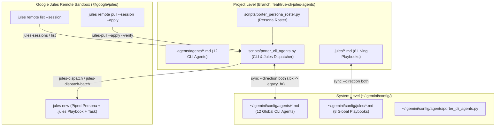

# True CLI Agents & Google Jules Architecture Guide

This guide documents the **12 True CLI Agents** built from the Jules operational playbooks (`.jules/*.md`) and the Spec-Kit Constitution for **Agentic Personal Porter**, engineered to operate across:
1. **Project Level** (`.agents/agents/`)
2. **System Level** (`~/.gemini/config/agents/`)
3. **Google Jules CLI (`@google/jules`)** remote VM sessions (`jules new`, `jules remote list/pull`, `jules teleport`)

For day-to-day operational commands, session ID discovery, and parallel dispatch instructions, see `documentation/architecture/jules-cli-runbook.md`.

---

## 1. Dual-Level + Google Jules Architecture

---

## 2. The 12 CLI & Google Jules Agent Roster

| Persona ID | Emoji & Name | Category | Living Playbook | Verification Gate |
| :--- | :--- | :--- | :--- | :--- |
| `silas` | 🏛️ **Silas** | Gatekeeper | `spec-kit-constitution.md` | `make verify-done` |
| `sentinel` | 🛡️ **Sentinel** | Jules Quality | `.jules/sentinel.md` | `make test-sentinel` |
| `bolt` | ⚡ **Bolt** | Jules Quality | `.jules/bolt.md` | `make test-bolt` |
| `palette` | 🎨 **Palette (Fiona)** | Jules Quality | `.jules/palette.md` | `make test-palette` |
| `archie` | 🏛️ **Archie** | Jules Quality | `.jules/archie.md` | `make test-archie` |
| `docdoc` | 📚 **DocDoc** | Jules Quality | `.jules/docdoc.md` | `make test-docdoc` |
| `dave` | ⚙️ **Dave** | Jules Quality | `.jules/dave.md` | `make test-dave` |
| `crii` | 🔍 **Crii** | Jules Quality | `.jules/crii.md` | `make test-crii` |
| `jovol` | ⚛️ **Jovol** | Jules Quality | `.jules/jovol.md` | `make test-jovol` |
| `backend-porter` | 🔧 **Backend Porter** | Domain Porter | `active-backend-tasks.md` | `make test-backend-porter` |
| `frontend-porter` | 🖥️ **Frontend Porter** | Domain Porter | `active-frontend-dev.md` | `make test-frontend-porter` |
| `agentic-porter` | 🤖 **Agentic Porter** | Domain Porter | `active-agent-dev.md` | `make test-agentic-porter` |

---

## 3. Modular Separation & Public Repository Hygiene

- **Roster Module (`scripts/porter_persona_roster.py`)**: Houses the `PersonaSpec` and `JulesSessionRow` data structures, the 12-agent `PERSONA_ROSTER`, and session persona detection logic.
- **CLI Dispatcher (`scripts/porter_cli_agents.py`)**: Handles cross-machine synchronization (`sync`), local verification gates (`verify`), and Google Jules CLI orchestration (`jules-dispatch`, `jules-dispatch-batch`, `jules-sessions`, `jules-pull`, `jules-teleport`).
- **Zero Personal Config Leakage**: Repository `<owner>/<repo>` slugs are resolved dynamically at runtime from `.git/config`, and binary paths are resolved via standard environment variables (`PORTER_JULES_BIN`, `PORTER_SYSTEM_CONFIG_DIR`) or `PATH` discovery.
