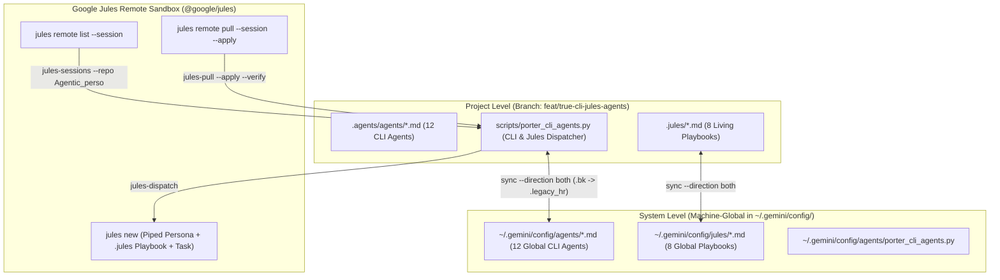

# True CLI Agents & Google Jules Integration Guide

This guide documents the **12 True CLI Agents** built from the Jules operational playbooks (`.jules/*.md`) and the Spec-Kit Constitution for **Agentic Personal Porter**, engineered to operate seamlessly across:
1. **Project Level** (`Agentic_personal_porter/.agents/agents/`)
2. **System Level** (`~/.gemini/config/agents/`)
3. **Google Jules CLI (`@google/jules`)** remote VM sessions (`jules new`, `jules remote list/pull`, `jules teleport`)

All work is isolated on the dedicated feature branch **`feat/true-cli-jules-agents`** to prevent conflicts when moving between your laptop and desktop.

---

## 1. Dual-Level + Google Jules Architecture



---

## 2. The 12 CLI & Google Jules Agent Roster

| Persona ID | Emoji & Name | Category | Google Jules Session Signature | Verification Gate |
| :--- | :--- | :--- | :--- | :--- |
| `silas` | 🏛️ **Silas** | Gatekeeper | `Persona: You are "Silas," 🏛️ - ...` | `uv run python scripts/porter_cli_agents.py verify silas` |
| `sentinel` | 🛡️ **Sentinel** | Jules Quality | `You are "Sentinel" 🛡️ - ...` | `uv run python scripts/porter_cli_agents.py verify sentinel` |
| `bolt` | ⚡ **Bolt** | Jules Quality | `You are "Bolt" ⚡ - ...` | `uv run python scripts/porter_cli_agents.py verify bolt` |
| `palette` | 🎨 **Palette (Fiona)** | Jules Quality | `You are "Palette" 🎨 - ...` | `uv run python scripts/porter_cli_agents.py verify palette` |
| `archie` | 🏛️ **Archie** | Jules Quality | `You are "Archie" 🏛️ - ...` | `uv run python scripts/porter_cli_agents.py verify archie` |
| `docdoc` | 📚 **DocDoc** | Jules Quality | `You are "DocDoc" 📚 - ...` | `uv run python scripts/porter_cli_agents.py verify docdoc` |
| `dave` | ⚙️ **Dave** | Jules Quality | `You are "Dave" ⚙️ - ...` | `uv run python scripts/porter_cli_agents.py verify dave` |
| `crii` | 🔍 **Crii** | Jules Quality | `You are "Crii" 🔍 - ...` | `uv run python scripts/porter_cli_agents.py verify crii` |
| `jovol` | ⚛️ **Jovol** | Jules Quality | `You are "Jovol" ⚛️ - ...` | `uv run python scripts/porter_cli_agents.py verify jovol` |
| `backend-porter` | 🔧 **Backend Porter** | Domain Porter | `You are "Backend Porter" 🔧 - ...` | `uv run python scripts/porter_cli_agents.py verify backend-porter` |
| `frontend-porter` | 🖥️ **Frontend Porter** | Domain Porter | `You are "Frontend Porter" 🖥️ - ...` | `uv run python scripts/porter_cli_agents.py verify frontend-porter` |
| `agentic-porter` | 🤖 **Agentic Porter** | Domain Porter | `You are "Agentic Porter" 🤖 - ...` | `uv run python scripts/porter_cli_agents.py verify agentic-porter` |

---

## 3. Google Jules CLI (`@google/jules`) Workflows

Because `porter_cli_agents.py` automatically locates `jules` (e.g. `C:\nvm4w\nodejs\jules.cmd` on Windows or `jules` on Linux/macOS) and pipes the complete composite prompt via `stdin`, every remote Jules session receives:
1. Your recognizable 1-line persona header on Line 1 (so `jules remote list --session` clearly shows `You are "Sentinel" 🛡️...`, `You are "Bolt" ⚡...`, `You are "Jovol" ⚛️...`, etc.),
2. The persona's full system instructions from `.agents/agents/<persona>.md`,
3. The live historical learnings from `.jules/<persona>.md` (plus instructions to append new learnings back into `.jules/<persona>.md`), and
4. The persona's mandatory verification gate (`make test-<persona>`).

### A. Inspecting Your Active Google Jules Sessions & Repos
```powershell
# List all GitHub repos connected to your Google Jules account
uv run python scripts/porter_cli_agents.py jules-repos

# Filter remote Jules sessions by repo, persona, or status
uv run python scripts/porter_cli_agents.py jules-sessions --repo Agentic_perso
uv run python scripts/porter_cli_agents.py jules-sessions --persona bolt
uv run python scripts/porter_cli_agents.py jules-sessions --persona sentinel --status "Awaiting"
```

### B. Dispatching a Persona Task to Google Jules (`jules-dispatch`)
```powershell
# Preview the exact composite prompt before sending to Google Jules (--dry-run)
uv run python scripts/porter_cli_agents.py jules-dispatch jovol "Audit frontend/js for Spec Kit token alignment" --dry-run

# Dispatch a live session to Google Jules for Agentic_personal_porter
uv run python scripts/porter_cli_agents.py jules-dispatch bolt "Optimize MongoDB batch projections in calendar sync" --repo Zebfred/Agentic_personal_porter

# Dispatch any persona to ANOTHER connected repository (e.g., Zebfred/Nexus_Website_code)
uv run python scripts/porter_cli_agents.py jules-dispatch jovol "Verify Spec Kit component primitives and RSC boundaries" --repo Zebfred/Nexus_Website_code

# Spawn 3 parallel Jules sessions for a high-priority adversarial stress test
uv run python scripts/porter_cli_agents.py jules-dispatch crii "Fuzz /process_journal boundary inputs" --repo Zebfred/Agentic_personal_porter --parallel 3
```

### C. Pulling or Teleporting a Jules Session & Auto-Verifying Locally
```powershell
# Preview the diff from a completed or awaiting Jules session
uv run python scripts/porter_cli_agents.py jules-pull 8225521754280442521

# Apply the Jules patch locally AND automatically run Bolt's verification gate!
uv run python scripts/porter_cli_agents.py jules-pull 8225521754280442521 --apply --verify bolt

# Or teleport directly to a session and run Silas's full verification gate
uv run python scripts/porter_cli_agents.py jules-teleport 6166048380930908176 --verify silas
```

---

## 4. Laptop $\leftrightarrow$ Desktop Sync & Local CLI Usage

### A. Syncing Between Laptop and Desktop
```powershell
# Bidirectional sync (newest file wins; overwritten files are backed up with .bk into .legacy_hr/)
uv run python scripts/porter_cli_agents.py sync --direction both
```

### B. Using the Agents in Antigravity CLI (`agy`)
- Type `/agents` inside `agy` to switch to any of the 12 personas (`silas`, `sentinel`, `bolt`, `palette`, `archie`, `docdoc`, `dave`, `crii`, `jovol`, `backend-porter`, `frontend-porter`, `agentic-porter`), or run:
  ```powershell
  uv run python scripts/porter_cli_agents.py run sentinel "Audit auth_middleware.py" --engine agy
  ```
