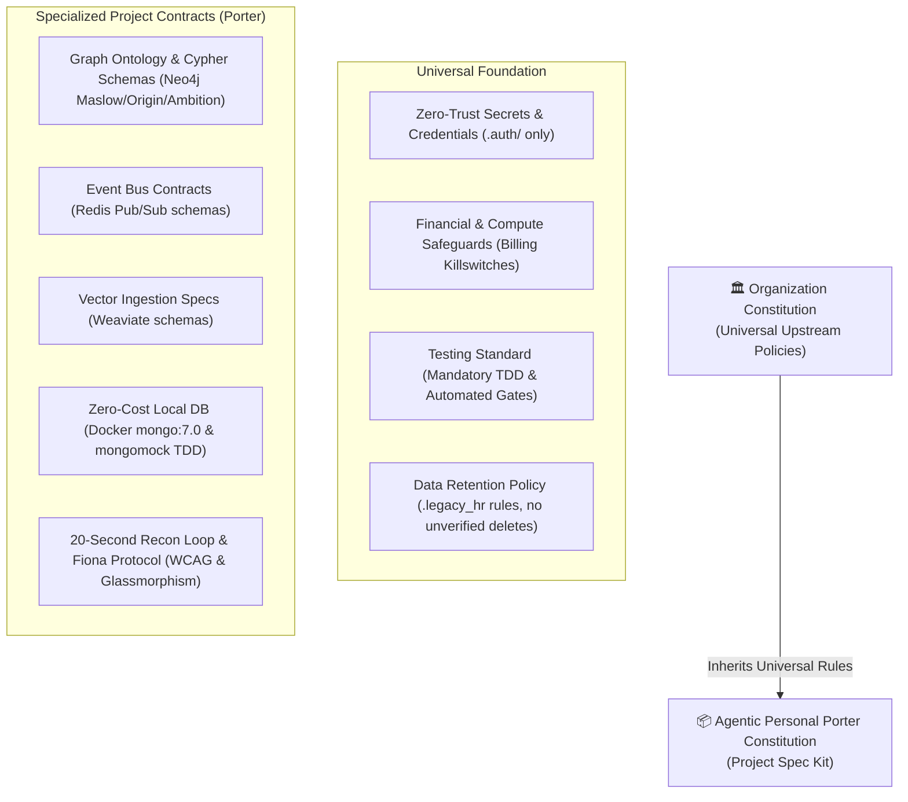

# Agentic Personal Porter Constitution

<!--
CONSTITUTION METADATA
Version: 1.2.0
Ratified: 2026-10-04
Last Amended: 2026-10-11
Scope: Agentic Personal Porter Core Ecosystem
Ecosystem Lifecycle: Mach 2 (Twin-Track Ingestion & 20-Second Recon Loop)
Toolchain Origin: Custom GitHub Fork (Spec-Kit SDD)
Preset Resolution: Local Project Memory > Installed Presets > Core Templates
Hierarchical Governance: Inherits Level 0 Universal Policies from Upstream Organization Governance (Maintained Privately)
-->

## Preamble
The **Agentic Personal Porter** is a sovereign, compassionate, non-judgmental digital companion and "Life Operating System." Its primary mandate is to bridge the psychological and operational delta ($\Delta$) between a human user's stated intentions (Google Calendar) and their ground reality (verified logs), grounded in Maslow's Hierarchy of Needs, Origin Story, and Ambition contexts.

Under our **Hierarchical Governance Architecture**, this project-level Constitution ("Porter Spec Kit") inherits foundational operational, security, and financial safeguards from our upstream organizational governance while defining Porter-specific architectural contracts.

This document serves as the supreme project-level architectural rulebook and specialized contract for Spec-Driven Development (SDD). All specifications, architecture plans, implementation tasks, and AI code generation must strictly conform to the universal principles and specialized contracts established herein.

---

## Core Principles

### Principle I: Sovereign Privacy & Zero-Trust Security (NON-NEGOTIABLE)
*(Inherited from Nexus LLC Constitution Principle I)*
1. **Zero-Trust Directory Boundary**: All credentials, OAuth refresh tokens, API keys, and sensitive user maps MUST reside exclusively in `.auth/` at the project root. This directory is strictly ignored by version control.
2. **Fail-Secure Startup**: Cryptographic secrets (`JWT_SECRET`, `PORTER_API_KEY`, database credentials) MUST NOT contain hardcoded fallbacks or default dev strings. If a required environment variable is missing, the application MUST fail fast and loudly on startup with an explicit error.
3. **Timing-Attack Immunity**: All sensitive token, API key, and password comparisons MUST use constant-time evaluation via `hmac.compare_digest()`. Standard equality (`==` or `!=`) on secrets is strictly forbidden.
4. **Safe Serialization**: Binary object deserialization via `pickle` is strictly prohibited. State and tokens MUST be serialized using language-agnostic JSON (e.g., `Credentials.from_authorized_user_file()`).
5. **Infrastructure Protection**: All administrative and operational endpoints with real-world compute or financial impact (e.g., `/wake_infrastructure`, billing management) MUST require authentication (`@require_api_key` or valid JWT). Unauthenticated compute triggers are considered critical vulnerabilities.
6. **Production Network Hardening**: Production entry points MUST default to `FLASK_DEBUG=False` and bind exclusively to designated host configurations. Interactive debuggers MUST NEVER be exposed on `0.0.0.0`.

### Principle II: Multi-Tenant Architectural Partitioning (NON-NEGOTIABLE)
1. **Single-Tenant Elimination**: The single-tenant "Hero" hardcoding has been formally dismantled. Accessing `os.environ.get("HERO_NAME")` is strictly prohibited in application logic.
2. **Tenant Context Propagation**: Tenant identity MUST be dynamically derived from the authenticated request context (`request.user_email` injected via JWT middleware) across all routes, agent pipelines, and database queries.
3. **Collision-Proof Identifiers**: All deterministic entity UUIDs MUST be generated using composite hashing of the tenant email and the source ID (e.g., `UUIDGenerator.generate_for_event(gcal_id, user_email)`).
4. **Database Scoping**: Every database query in Neo4j (Cypher) and MongoDB MUST explicitly scope its match criteria by `user_email`.

### Principle III: Database Discipline & Idempotent Persistence
1. **Connection Pooling Integrity (Bolt Protocol)**: The Neo4j driver MUST be maintained as a thread-safe singleton. Instantiating a new `GraphDatabase.driver` per function call is forbidden. Driver closure MUST NEVER be attached to per-request teardown hooks (such as Flask's `@app.teardown_appcontext`).
2. **Strict Idempotency**: All ingestion and synchronization pipelines into Neo4j MUST use idempotent `MERGE` statements keyed on immutable constraints (`gcal_id`, `user_email`) to prevent duplicate nodes or corrupt relationships.
3. **Batch Over Iteration**: Iterative network calls inside loops (such as calling `collection.update_one()` inside a `for` loop) are prohibited. Updates MUST be batched using `bulk_write(ops, ordered=False)` to eliminate $O(n)$ network roundtrips.
4. **Temporal Ingestion Safeguards**: Google Calendar backfill synchronization MUST process events in chronological batches of no more than 1 month per execution chunk to prevent API rate-limit violations and LLM context saturation.

### Principle IV: 20-Second Recon Loop & Frontend Accessibility (Fiona & Palette)
1. **The 20-Second Rule**: Any interface layout or verification workflow requiring more than three clicks to log or verify an actual activity is classified as a "UI failure."
2. **Semantic CSS Tokens & Project Palette**: All frontend components MUST use semantic design tokens and CSS variables defined in the root stylesheet (e.g., `--primary-action`, `--text-on-primary`) rather than hardcoded or generic styles.
3. **Glassmorphic Hero Aesthetic**: The UI must maintain a high-contrast, responsive, glassmorphic visual language built with Vanilla JavaScript and Tailwind CSS. A sharp visual distinction MUST be maintained between the Personal Hero view and the Nexus Business/Admin view.
4. **WCAG Accessibility (A11y)**:
   - Every icon-only button (e.g., `<`, `>`, `×`) MUST have a descriptive `aria-label`.
   - Every form input and textarea MUST have an associated `<label>` with a matching `for` attribute (using `.sr-only` if visually hidden).
   - Visually hidden interactive elements (such as custom toggles) MUST preserve visible keyboard focus rings using the `:focus-visible` pseudo-class.
5. **State Synchronization**: The client-side `weeklyLog` stored in `localStorage` MUST remain continuously and deterministically synchronized with the backend Neo4j graph.

### Principle V: Non-Destructive File Retention & Lifecycle (.legacy_hr)
*(Inherited from Nexus LLC Constitution Principle IV)*
1. **Zero Permanent Deletion**: Files MUST NEVER be permanently deleted. Outdated, refactored, or deprecated files MUST be relocated to the `.legacy_hr/` archive directory at the project root.
2. **Token Window Protection**: The `.legacy_hr/` directory MUST remain listed in `.gitignore` and `.geminiignore` to prevent obsolete code from polluting AI context windows.
3. **Mandatory Backup Discipline**: Before modifying any existing file, a backup with a `.bk` extension MUST be created.
4. **Clean Exit**: Upon task completion, all lingering `.bk*` files MUST be independently collected and moved into `.legacy_hr/`.
5. **Artifact Export**: Upon task or sprint completion, finalized `task.md` and `walkthrough.md` artifacts MUST be exported to `agentic-private-brain/completed-tasks/` matching kebab-case format: `YYYY-MM-DD-task-name-task.md` and `YYYY-MM-DD-task-name-walkthrough.md`.

### Principle VI: Documentation Supremacy, Kebab-Case Naming & Domain Scoping
*(Inherited from Nexus LLC Constitution Principle V)*
1. **Markdown Storage Boundary**: All markdown (`.md`) documentation MUST be stored within the `documentation/` directory (lowercase). No markdown files are permitted in the project root with the sole exception of `README.md`.
2. **Kebab-Case Naming Standard**: All markdown files MUST use `kebab-case` naming (e.g., `quick-start.md`, `spec-kit-constitution.md`, `active-backend-tasks.md`). UPPERCASE or snake_case markdown file names are prohibited.
3. **Automatic Routing**: Any request to produce documentation MUST automatically route to `documentation/[category]/[kebab-name].md` without requiring explicit user instruction.
4. **Domain Alignment**: Development must be strictly scoped to the active domain document (e.g., `documentation/current_work/active-[domain].md`). Agents MUST read the active domain document before proposing modifications and update it with a verified audit trail upon completion.

### Principle VII: Verification-Gated Delivery & Code Hygiene (Silas Protocol)
*(Inherited from Nexus LLC Constitution Principle III)*
1. **The Push-Button Definition of Done Gate**: A task is strictly incomplete until `make verify-done` exits with return code 0:
   - Lint & style check (`uv run ruff check src tests`)
   - Static type check (`uv run mypy src`)
   - Unit test suite (`uv run pytest tests/unit -v --tb=short`)
2. **The 3-Step "Red-Green-Verify" Loop**:
   - **Step 1 (Red — Contract Test)**: Author tests against mocked dependencies asserting failure on unimplemented requirements.
   - **Step 2 (Green — Implementation)**: Author minimal code to pass the unit tests.
   - **Step 3 (Verify — Automated Gate)**: Pass `make verify-done`.
3. **Contract & Schema-First Typing**: Before implementing business logic, define exact data input/output models with Pydantic v2 schemas in `src/schemas/` or `specs/contracts/` to ensure early validation and static type safety.
4. **Error Transparency**: Error handling must produce clear, actionable, diagnostic messages. Bare `except:` or `except Exception: pass` statements that swallow exceptions are strictly prohibited.
5. **Targeted Linting Boundary**: When running `ruff check`, the `--fix` flag MUST NEVER be executed globally across `src/` (`uv run ruff check src --fix`). Automated fixes must be restricted to explicitly modified files.
6. **Shell Script Reliability**: All automation and deployment shell scripts MUST enforce `set -euo pipefail`, declare absolute paths, and ensure directory existence using `mkdir -p`.

### Principle VIII: Preset Hierarchy & Resolution Supremacy
1. **Local Constitution Precedence**: The project-local constitution at `.specify/memory/constitution.md` (and its authoritative mirror at `documentation/architecture/spec-kit-constitution.md`) strictly supersedes any installed preset or core template defaults from the Spec Kit fork.
2. **Immutable Project Invariants**: Running `specify preset update` or `specify init` MUST NEVER overwrite or weaken project-specific invariants (such as single-tenant elimination, Neo4j singleton connection pooling, or `.legacy_hr` retention policies).
3. **Template Scaffolding Contract**: Spec Kit planning templates (`plan-template.md`) pulled from the fork's preset stack MUST evaluate against the live local constitution rather than hardcoded generic rules.

### Principle IX: Zero-Cost Local Database Architecture & Fast TDD Iteration
1. **No Cloud Invoices for Local Development**: Managed cloud database instances (Atlas, Weaviate Cloud, remote Neo4j Aura) MUST NOT be required for day-to-day development or automated testing. Local development stacks must run at $0.00 infrastructure cost.
2. **In-Memory `mongomock` for Unit Tests**: All unit tests interfacing with MongoDB MUST execute against `mongomock` via the `mock_mongo` test fixture. Tests must run completely offline with zero network calls and execute in sub-second timeframes (<10ms per test).
3. **Local Docker Compose Services**: For end-to-end and multi-service testing, official lightweight container images (`mongo:7.0`, `redis:7-alpine`) MUST be orchestrated locally via `docker-compose.yml` with persistent named volumes.
4. **Isolated Test Environments**: Cloud credentials and remote databases must never be called during unit tests; tests must pass deterministically even without an active internet connection.

---

## Technical & Runtime Contracts

| Domain | Standard / Tooling | Enforcement Invariant |
| :--- | :--- | :--- |
| **Governance Tier** | Organization Governance | Inherits Level 0 universal policies from upstream organization governance (maintained privately). |
| **Python Runtime** | Python 3.12+ in Conda (`agentic_porter`) | Absolute imports using `src.` prefix; `sys.path` initialized at entry points. |
| **Package Management** | `uv` via `pyproject.toml` workspace | No global `pip install`. All dependencies locked and synced via `uv`. |
| **Backend Web Framework** | Flask with modular blueprints | Global CORS management via `flask_cors`; no ad-hoc origin echoing. |
| **Primary Identity Graph**| Neo4j (Bolt protocol) | Managed singleton driver; parameterized queries; idempotent Cypher `MERGE`. |
| **Landing & Timeseries DB**| MongoDB (`mongo:7.0` in Docker / `mongomock` in TDD) | Batched `bulk_write`; compound indices on `(user_email, start_time)`. $0.00 cloud cost. |
| **Event Bus & Caching** | Redis 7 (`porter-redis` in Docker) | Pub/Sub event schemas; consumer group workers for background jobs. |
| **Automated Quality Gate** | `make verify-done` | Ruff (lint) + Mypy (types) + Pytest (sub-second unit tests) must exit 0. |
| **Frontend Presentation** | Vanilla JS + Tailwind CSS | Responsive, mobile-first ("Doing" state); semantic design tokens. |
| **Documentation Standards**| `documentation/` with kebab-case `.md` | Never in root (except `README.md`); kebab-case naming enforced. |
| **Terminal / CLI Defaults**| `vim` / `vi` | All editor suggestions and CLI commands default to `vim`/`vi` over `nano`. |

---

## Specialized Agent Personas & Protocols

- **Silas (Static Code Auditor)**: Enforces zero-tolerance for AI bloat, algorithmic inefficiency ($O(n^2)$ loops, N+1 queries), sovereignty leaks, and missing error propagation.
- **Fiona (Lead Frontend Architect)**: Enforces the 20-second gatekeeper rule ($\le 3$ clicks), perceived latency metrics ($L_p$), WCAG A11y standards, and the Heroic glassmorphic design system.
- **Bill (FinOps & Cloud Accounting)**: Safeguards cloud budgets, verifies Cloud Run billing killswitches, ensures programmatic billing notifications, and blocks unauthenticated compute exposure.

---

## Governance & Amendment Procedure

1. **Superseding Authority**: This Constitution represents the supreme project-level architectural constraint. No individual specification (`spec.md`) or implementation plan (`plan.md`) may override these principles.
2. **The Constitution Check**: Every technical plan created under Spec Kit MUST include an explicit `## Constitution Check` section verifying compliance against Principles I through IX.
3. **Critical Conflict Resolution**: If `/speckit.analyze` or an agent audit identifies a conflict with a constitution requirement (marked MUST or MUST NOT), the issue is classified as **CRITICAL**. The specification or plan must be revised—the principle cannot be bypassed.
4. **Amendment Process**:
   - Amendments require explicit rationale, a documented risk assessment, and maintainer verification.
   - Versioning follows Semantic Versioning (SemVer):
     - **MAJOR**: Structural alteration, deprecation, or removal of an architectural principle.
     - **MINOR**: Addition of new principles, agent personas, or technical contracts.
     - **PATCH**: Typographical fixes, clarifications, or non-semantic wording updates.
   - Any amendment must be recorded with a corresponding Sync Impact Report updating dependent templates and active sprint documents in `documentation/current_work/`.
5. **Preset Synchronization**: When introducing or updating presets from our GitHub fork, run `specify preset resolve` to verify that template overrides correctly map to our project standards without shadowing local architecture rules.
