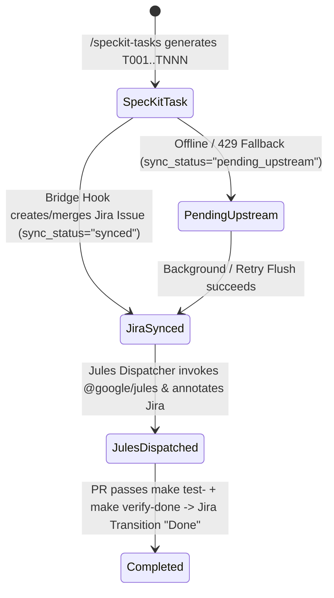

# Phase 1 Data Model: Unified Spec-Kit, Jira, and Jules Bridge

**Feature**: `002-jira-jules-bridge`
**Date**: 2026-10-17
**Spec**: [spec.md](spec.md)

---

## 1. Core Pydantic v2 Schemas (`src/schemas/jira_models.py`)

All external inputs, HTTP payloads, and inter-service messages are strictly validated via Pydantic v2 models before business logic execution (**Principle VII.3 — Contract & Schema-First Typing**).

### 1.1 `PersonaType` (Enum / Literal)
Valid persona identifiers aligned with `documentation/architecture/agent-roster.md`:
- `"sentinel"` — Security & Hardening (`.jules/sentinel.md`, `make test-sentinel`)
- `"bolt"` — Performance & Database Optimization (`.jules/bolt.md`, `make test-bolt`)
- `"palette"` — Frontend, Aesthetics & Accessibility (`.jules/palette.md`, `make test-palette`)
- `"archie"` — System Architecture & Modularity (`.jules/archie.md`, `make test-archie`)
- `"docdoc"` — Documentation & Knowledge Governance (`.jules/docdoc.md`, `make test-docdoc`)
- `"dave"` — DevOps, CI/CD & Infrastructure (`.jules/dave.md`, `make test-dave`)
- `"crii"` — Adversarial Inquisitor & Failure Modes (`.jules/crii.md`, `make test-crii`)
- `"jovol"` — JS Functional Components & Spec Kit (`.jules/jovol.md`, `make test-jovol`)
- `"silas"` — Default Final Verification Gatekeeper (`.agent/rules/silas_protocol.md`, `make verify-done`)

### 1.2 `SyncStatus` (Enum / Literal)
- `"synced"` — Local record matches upstream Jira state.
- `"pending_upstream"` — Local creation/update queued for upstream Jira push (resilient to offline/429 states).
- `"unlinked"` — Remote issue was deleted or moved; retained locally for audit history.
- `"conflict"` — Divergent timestamps detected; local Identity Graph acts as authoritative source.

### 1.3 `SpecKitTaskItem`
Represents a parsed task line from `specs/NNN-feature/tasks.md`:
| Field | Type | Constraints | Description |
| :--- | :--- | :--- | :--- |
| `task_id` | `str` | Regex `^T\d{3,}$` | Canonical Spec-Kit task identifier (e.g., `T001`). |
| `feature_id` | `str` | `min_length=3, max_length=120` | Feature folder identifier (e.g., `002-jira-jules-bridge`). |
| `title` | `str` | `min_length=3, max_length=255` | Concise summary (`T001: <description>`). |
| `description` | `str` | `max_length=15000` | Full task body including phase, user story, and acceptance criteria. |
| `is_parallel` | `bool` | Default `False` | True when `[P]` marker is present in `tasks.md`. |
| `user_story` | `Optional[str]` | Regex `^US\d+$` or `None` | Optional user story tag (e.g., `US1`). |
| `target_paths` | ` list[str]` | Default `[]` | Extracted file paths referenced in the task line. |
| `persona` | `PersonaType` | Default `"silas"` | Assigned or inferred quality persona profile. |
| `completed` | `bool` | Default `False` | True when `- [x]` or `- [X]` is checked in `tasks.md`. |

### 1.4 `JiraIssueRecord` (Tracked Issue Record)
Represents a tenant-scoped Jira issue cached in MongoDB (`jira_issues_staging`) and linked to the Neo4j Identity Graph:
| Field | Type | Constraints | Description |
| :--- | :--- | :--- | :--- |
| `uuid` | `str` | Deterministic UUIDv5 | Generated via `UUIDGenerator.generate_for_jira_issue(jira_key, user_email)`. |
| `user_email` | `str` | Required, non-empty | Authenticated tenant owner (`request.user_email`). |
| `jira_key` | `str` | Regex `^([A-Z][A-Z0-9_]+-\d+|LOCAL-T\d{3,})$` | Upstream Jira key (e.g., `PORTER-42`) or provisional local key when offline. |
| `project_key` | `str` | Regex `^[A-Z][A-Z0-9_]+$` | Target Jira project key (e.g., `PORTER`). |
| `issue_type` | `Literal["Epic", "Story", "Task", "Sub-task"]` | Default `"Task"` | Jira issue hierarchy type. |
| `task_id` | `Optional[str]` | Regex `^T\d{3,}$` or `None` | Linked Spec-Kit canonical task ID. |
| `feature_id` | `Optional[str]` | `max_length=120` | Linked Spec-Kit feature directory slug. |
| `epic_key` | `Optional[str]` | `max_length=64` | Parent Jira Epic key (if child Story/Task). |
| `summary` | `str` | `min_length=1, max_length=255` | Issue summary/title. |
| `description` | `str` | `max_length=20000` | Formatted specification and acceptance criteria body. |
| `status` | `str` | Default `"To Do"` | Current workflow status (`To Do`, `In Progress`, `In Review`, `Done`). |
| `persona` | `PersonaType` | Default `"silas"` | Mapped `.jules/<persona>.md` quality persona. |
| `labels` | `list[str]` | Default `[]` | Issue labels (e.g., `["speckit", "jules:bolt", "feature:002-jira-jules-bridge"]`). |
| `sync_status` | `SyncStatus` | Default `"synced"` | Synchronization state between local MongoDB and Jira Cloud. |
| `correlation_id` | `str` | Non-empty string | End-to-end lineage trace ID (`src/utils/correlation.py`). |
| `jules_session_id` | `Optional[str]` | `max_length=128` | Dispatched Google Jules session reference, if delegated. |
| `updated_at` | `str` | ISO-8601 UTC timestamp | Last modification timestamp. |

### 1.5 `JulesWorkOrder`
Represents a self-contained asynchronous coding delegation package formatted for `@google/jules`:
| Field | Type | Constraints | Description |
| :--- | :--- | :--- | :--- |
| `work_order_id` | `str` | Deterministic UUIDv5 | Unique identifier for the work order. |
| `user_email` | `str` | Required, non-empty | Tenant owner initiating dispatch. |
| `jira_key` | `str` | Required | Source Jira issue key (e.g., `PORTER-42`). |
| `task_id` | `Optional[str]` | Regex `^T\d{3,}$` or `None` | Linked Spec-Kit task ID (`T001`). |
| `feature_id` | `str` | Required | Feature directory name (`002-jira-jules-bridge`). |
| `persona` | `PersonaType` | Required | Assigned persona (`sentinel`, `bolt`, `palette`, etc.). |
| `playbook_path` | `str` | Relative path | Path to persona playbook (e.g., `.jules/bolt.md`). |
| `target_paths` | `list[str]` | Default `[]` | Scoped files for the coding session. |
| `verification_commands` | `list[str]` | Non-empty | E.g., `["make test-bolt", "make verify-done"]`. |
| `formatted_prompt` | `str` | `min_length=20, max_length=30000` | Complete prompt payload passed to `jules new`. |
| `dry_run` | `bool` | Default `True` | Whether the work order was generated as a preview or live-dispatched. |
| `dispatch_status` | `Literal["preview", "queued", "dispatched", "failed"]` | Default `"preview"` | Execution status of the Jules delegation. |
| `jules_session_id` | `Optional[str]` | `None` or session string | Returned session ID from `@google/jules`. |
| `correlation_id` | `str` | Non-empty string | Shared lineage correlation ID. |

---

## 2. Database Storage & Indexing Contracts

### 2.1 MongoDB Collections (`src/config.py` -> `MongoConfig`)
- `JIRA_STAGING_COLLECTION = "jira_issues_staging"`
  - **Compound Index**: `[("user_email", ASCENDING), ("updated_at", DESCENDING)]`
  - **Unique Deduplication Index**: `[("user_email", ASCENDING), ("jira_key", ASCENDING)]`
  - **Batch Projection Rule (Bolt)**: Deduplication lookups MUST project `{"_id": 0, "jira_key": 1, "task_id": 1, "status": 1, "sync_status": 1}`.
- `JULES_WORK_ORDERS_COLLECTION = "jules_work_orders"`
  - **Compound Index**: `[("user_email", ASCENDING), ("work_order_id", ASCENDING)]`

### 2.2 Neo4j Identity Graph Mapping
Synchronized Jira issues map idempotently into the user's Identity Graph using `MERGE` keyed on `(uuid, user_email)`:
```cypher
MATCH (h:Hero {user_email: $user_email})
MERGE (q:Quest:Intention {uuid: $uuid, user_email: $user_email})
SET q.jira_key = $jira_key,
    q.task_id = $task_id,
    q.summary = $summary,
    q.status = $status,
    q.persona = $persona,
    q.updated_at = $updated_at
MERGE (h)-[:PURSUES_QUEST]->(q)
```

---

## 3. State Transitions


