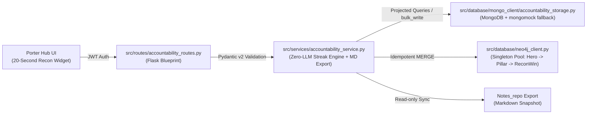

# Implementation Plan: North Star Accountability & Weekly Streak Engine (`004-north-star-accountability`)

**Branch**: `feat/004-north-star-accountability` | **Date**: 2026-11-22 | **Spec**: [spec.md](./spec.md)

---

## 1. Technical Architecture & Unidirectional Layering (`Archie`)

Strictly preserves the Porter unidirectional dependency graph (`core <- database <- services <- routes`):

---

## 2. Constitutional Compliance Check

| Gate / Persona | Invariant | Compliance Strategy |
| :--- | :--- | :--- |
| **Sentinel** | Multi-tenant JWT isolation, XSS/null-byte sanitization, zero secrets | Extract `request.user_email` exclusively from JWT middleware; Pydantic validators strip control chars and reject `\x00`. |
| **Archie** | Contract-first Pydantic v2 schemas, `< 200` lines/script, `< 60` lines/fn | Define `src/schemas/accountability_models.py` first; split storage, streak calculator, and markdown exporter into focused modules. |
| **Bolt** | Explicit Mongo projections, DESCENDING compound indexes, singleton Neo4j pool | Define `PILLAR_PROJECTION` and `CHECKIN_PROJECTION`; index `(user_email, iso_week DESC)` and `(user_email, pillar_id)` unique. |
| **FinOps / Dave** | Zero LLM token burn for deterministic streak computation | Pure Python deterministic ISO-week streak math; LLM reflection remains strictly opt-in during weekly Socratic review. |
| **Palette (Fiona)** | 20-Second Recon Loop, ARIA labels, semantic CSS tokens | One-click pillar chips + numeric duration stepper; async loading spinner on check-in buttons; zero hardcoded hex colors. |
| **Silas** | `make verify-done` (`ruff`, `mypy`, `bandit`, `pytest`), `<= 35` files/PR | Split into stacked PRs if UI + Backend exceed 20 files; schema + service tests run in mock-first TDD mode. |

---

## 3. Target Module Footprint

| Layer | File | Responsibility |
| :--- | :--- | :--- |
| **Contracts** | `src/schemas/accountability_models.py` | Pydantic v2 request/response models & deterministic validators (implemented in this spec PR). |
| **Storage** | `src/database/mongo_client/accountability_storage.py` | Tenant-scoped CRUD, idempotent check-in upsert, indexed week-window queries. |
| **Service** | `src/services/accountability_service.py` | Deterministic ISO-week streak engine, Grace/Vacation mode freeze math, Markdown snapshot builder. |
| **Routes** | `src/routes/accountability_routes.py` | Flask Blueprint registered in `src/app.py` under `/api/accountability/*`. |
| **Tests** | `tests/unit/test_accountability_models.py`, `tests/unit/test_accountability_service.py` | Boundary fuzzing (`Crii`), tenant isolation, grace-week freeze, and Markdown export assertions. |
